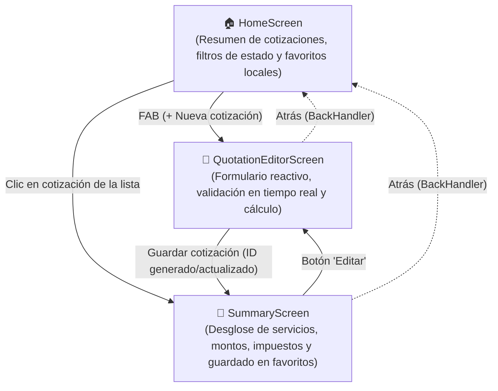
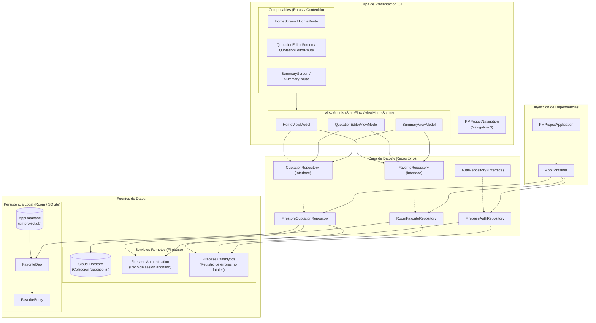

# Eventos Master 
Sistema Móvil de Gestión y Cotización de Eventos

> **Proyecto de Programación Móvil — Universidad del Valle de Guatemala (UVG)**  
> **Ciclo 2 - 2026**  
> **Equipo:** Raquel Vega, Juan Pablo Flores, Abigail Escobar  

---

## 1. Problema y Solución

* **Usuario objetivo:** Organizadores de eventos y coordinadores independientes.
* **Problema validado:** Actualmente realizan cotizaciones en papel o chats dispersos de mensajería, lo que provoca errores humanos en el cálculo de impuestos y subtotales, pérdida de cotizaciones previas y falta de trazabilidad en las solicitudes aprobadas o pendientes.
* **Propuesta de valor:** *Eventos Master* es una aplicación móvil nativa en Android construida con Jetpack Compose que centraliza la creación, edición, cálculo automático y seguimiento en tiempo real de presupuestos de eventos, ofreciendo soporte offline con persistencia local y sincronización segura en la nube.

---

## 2. Cómo Ejecutar el Proyecto

### Requisitos de Entorno y Compatibilidad
* **Android Studio:** Android Studio Meerkat (2024.3+) o versión 2025/2026 (requerido para compatibilidad con Android Gradle Plugin 9.2+ y Gradle 9.4+).
* **JDK:** **Java 21 (Obligatorio).** El proyecto incluye el archivo `gradle/gradle-daemon-jvm.properties` con toolchain configurado en versión 21; Gradle descargará y aprovisionará automáticamente el JDK 21 adecuado para la compilación.
* **SDK Android:**
  * `compileSdk = 37` (Minor API Level 1 / Android 16 Preview)
  * `targetSdk = 36`
  * `minSdk = 34` (Android 14)
* **Conectividad:** Dispositivo físico o emulador con Android 14 (API 34)+ y Google Play Services activados.

### Pasos de Instalación y Ejecución
1. Clonar el repositorio:
   ```bash
   git clone https://github.com/ADAESXX/PMProject.git
   cd PMProject
   ```
2. Cambiar a la rama de entrega final:
   ```bash
   git checkout feature/-entregafinal
   ```
3. **Configuración de Firebase:** El archivo `app/google-services.json` ya se encuentra incluido en el repositorio dentro del directorio `app/`, configurado con el proyecto activo de Firebase (`eventos-master-pm`), por lo que compila y se conecta sin pasos manuales adicionales.
4. **Compilación y ejecución directa por terminal:**  
   *(Se recomienda compilar por línea de comandos mediante el Gradle Wrapper para garantizar la ejecución limpia independientemente de la versión gráfica del IDE):*
   ```bash
   # 1. Ejecutar pruebas unitarias locales
   ./gradlew testDebugUnitTest

   # 2. Compilar el APK de depuración
   ./gradlew assembleDebug

   # 3. Instalar directamente en el emulador o dispositivo conectado
   ./gradlew installDebug
   ```

---

## 3. Flujo de Usuario

El flujo principal está compuesto por tres pantallas clave orquestadas mediante **Navigation 3**, permitiendo una navegación fluida, paso de parámetros tipados y manejo del botón *Atrás* con `BackHandler`:



---

## 4. Arquitectura del Sistema

La aplicación implementa una arquitectura limpia basada en **MVVM (Model-View-ViewModel)** y el patrón **Repository**, garantizando separación estricta de responsabilidades, inyección manual de dependencias y observabilidad reactiva con `StateFlow` y Coroutines.



---

## 5. Mínimos Técnicos (M1 a M15)

| ID | Criterio de Evaluación | Cumplimiento y Enlace al Código Real |
| :--- | :--- | :--- |
| **M1** | Tema propio consistente (colores y tipografía Material 3). | Implementado en [`Theme.kt`](app/src/main/java/gt/uvg/pmproject/ui/theme/Theme.kt), paleta en [`Color.kt`](app/src/main/java/gt/uvg/pmproject/ui/theme/Color.kt) y tipografías en [`Type.kt`](app/src/main/java/gt/uvg/pmproject/ui/theme/Type.kt). |
| **M2** | Navegación con paso de argumentos y botón Atrás. | Orquestado con Navigation 3 en [`PMProjectNavigation.kt`](app/src/main/java/gt/uvg/pmproject/ui/navigation/PMProjectNavigation.kt#L23-L33) con `PMProjectNavKey.Summary(quotationId)` y `BackHandler`. |
| **M3** | Lista `LazyColumn` usando `key`. | Implementado en [`HomeScreen.kt`](app/src/main/java/gt/uvg/pmproject/ui/screens/home/HomeScreen.kt#L138) con `key = { "favorite-${it.quotationId}" }` y `key = { it.id }`. |
| **M4** | Formulario con 3+ campos validados en tiempo real, mensajes de error y botón condicional. | Funciones puras de validación en [`QuotationFormValidation.kt`](app/src/main/java/gt/uvg/pmproject/ui/screens/quotationeditor/QuotationFormValidation.kt) y enlace reactivo en [`QuotationEditorScreen.kt`](app/src/main/java/gt/uvg/pmproject/ui/screens/quotationeditor/QuotationEditorScreen.kt). |
| **M5** | MVVM con `StateFlow` inmutable y separación Stateless/Stateful. | ViewModels [`HomeViewModel.kt`](app/src/main/java/gt/uvg/pmproject/ui/screens/home/HomeViewModel.kt), [`QuotationEditorViewModel.kt`](app/src/main/java/gt/uvg/pmproject/ui/screens/quotationeditor/QuotationEditorViewModel.kt), [`SummaryViewModel.kt`](app/src/main/java/gt/uvg/pmproject/ui/screens/summary/SummaryViewModel.kt) con `HomeRoute` (Stateful) y `HomeScreen` (Stateless). |
| **M6** ★ | Repository único: sin Firebase ni Room en UI ni ViewModels. | Interfaces [`QuotationRepository.kt`](app/src/main/java/gt/uvg/pmproject/data/QuotationRepository.kt) y [`FavoriteRepository.kt`](app/src/main/java/gt/uvg/pmproject/data/FavoriteRepository.kt). Cero imports de Firebase o Room fuera de `data`. |
| **M7** | Inyección manual por constructor. | ViewModels reciben dependencias por constructor vía `factory(...)` provistas por [`AppContainer.kt`](app/src/main/java/gt/uvg/pmproject/data/AppContainer.kt). |
| **M8** | Coroutines suspend / Flow lanzadas desde `viewModelScope`. | Flujos reactivos `Flow` transformados con `.stateIn(viewModelScope)` y mutaciones suspendidas en `viewModelScope.launch` en ViewModels. |
| **M9** ★ | Firestore: lectura/escritura en colección principal con data classes de dominio. | Implementado en [`FirestoreQuotationRepository.kt`](app/src/main/java/gt/uvg/pmproject/data/FirestoreQuotationRepository.kt) mapeando documentos a [`Quotation.kt`](app/src/main/java/gt/uvg/pmproject/model/Quotation.kt). |
| **M10** ★ | Estados visibles (Cargando, Vacío, Error, Sin conexión). | Componentes visuales en [`StateViews.kt`](app/src/main/java/gt/uvg/pmproject/ui/components/StateViews.kt) (`LoadingView`, `MessageView`, `NoticeBanner`) renderizados según `HomeUiState`. |
| **M11** | Room: Entity, DAO y Database funcional persistente. | Base de datos local [`AppDatabase.kt`](app/src/main/java/gt/uvg/pmproject/data/local/AppDatabase.kt), [`FavoriteDao.kt`](app/src/main/java/gt/uvg/pmproject/data/local/FavoriteDao.kt) y [`FavoriteEntity.kt`](app/src/main/java/gt/uvg/pmproject/data/local/FavoriteEntity.kt). |
| **M12** | Convenciones del curso y Kotlin idiomático. | Estructura modularizada en paquetes `data`, `model` y `ui`, nomenclaturas en CamelCase y PascalCase, inmutabilidad y limpieza de código. |
| **M13** | Crashlytics integrado para errores no fatales en Repository. | Errores capturados reportados con `crashlytics.recordException(exception)` en [`FirestoreQuotationRepository.kt`](app/src/main/java/gt/uvg/pmproject/data/FirestoreQuotationRepository.kt#L165-L168) y [`RoomFavoriteRepository.kt`](app/src/main/java/gt/uvg/pmproject/data/RoomFavoriteRepository.kt#L75-L78). |
| **M14** ★ | Build en Firebase App Distribution con notas de versión e instalado por testers. | Publicado con `versionCode = 2` y `versionName = "1.1"` ([`app/build.gradle.kts`](app/build.gradle.kts#L22-L23)) y distribuido a testers externos. |
| **M15** ★ | Flujo principal sin bugs críticos ni pérdida de datos. | Validación exhaustiva del flujo completo: crear, listar, editar, marcar favoritos en Room y persistencia Firestore en modo online/offline. |

---

## 6. Alcance del Proyecto

### User Stories Dentro (Cumplidas al 100%)
* **US-01:** Como organizador de eventos, quiero ver un resumen de mis cotizaciones agrupadas por estado (Borrador, Enviada, Aprobada) y acceder a mis cotizaciones favoritas incluso sin internet. *(Cumplida)*
* **US-02:** Como usuario, quiero crear una nueva cotización ingresando cliente, tipo de evento, fecha y servicios detallados, obteniendo subtotales e impuestos calculados en tiempo real. *(Cumplida)*
* **US-03:** Como usuario, quiero validar que el formulario no permita guardar datos incompletos o vacíos, recibiendo retroalimentación visual inmediata. *(Cumplida)*
* **US-04:** Como usuario, quiero ver el desglose completo de una cotización y poder marcarla o desmarcarla como favorita para acceso rápido local. *(Cumplida)*
* **US-05:** Como usuario, quiero editar una cotización existente y sincronizar los cambios de forma inmediata en la base de datos central. *(Cumplida)*

### User Stories Fuera (Deliberadamente descartadas para la versión 1.1)
* **US-06:** Exportación directa de la cotización a documento PDF con plantilla membretada.
* **US-07:** Envío automatizado de presupuesto por WhatsApp o correo electrónico al cliente.
* **US-08:** Pasarela de pago en línea para cobrar anticipos de eventos.
* **US-09:** Gestión avanzada de roles de usuario y permisos por sucursales.

---

## 7. Referencias y Uso de Inteligencia Artificial

### Documentación Consultada
* Documentación oficial de Android: [Jetpack Compose](https://developer.android.com/jetpack/compose), [Navigation Compose & Nav 3](https://developer.android.com/guide/navigation), [Room Database](https://developer.android.com/training/data-storage/room).
* Documentación oficial de Firebase: [Firebase Firestore para Android](https://firebase.google.com/docs/firestore), [Firebase Crashlytics SDK](https://firebase.google.com/docs/crashlytics/get-started?platform=android), [Firebase App Distribution](https://firebase.google.com/docs/app-distribution).

### Declaración de Uso de IA
* **Herramientas utilizadas:** Claude (Anthropic), Antigravity (Google DeepMind) y Gemini 3.8.
* **Para qué se utilizó:**
  1. Identificación y depuración de errores de configuración en Gradle y KSP al migrar dependencias a Kotlin 2.4.
  2. Asistencia en el diseño de expresiones regulares estrictas y modularización de funciones puras en `QuotationFormValidation.kt`.
  3. Formulación y estructuración de diagramas de arquitectura en sintaxis Mermaid para el README técnico.
  4. Auditoría y verificación exhaustiva de los criterios de la rúbrica de la Entrega Final (mínimos técnicos M1 a M15) y coherencia de arquitectura para asegurar el cumplimiento de la métrica.
* **Cómo se verificó el resultado:**
  * Cotejo manual punto por punto contra la rúbrica oficial de Canvas y comprobación de enlaces directos a las funciones de cumplimiento.
  * Compilación limpia mediante `./gradlew assembleDebug`.
  * Ejecución automatizada de pruebas unitarias locales con `./gradlew testDebugUnitTest`.
  * Pruebas manuales en dispositivos físicos reales desconectando Wi-Fi/Datos móviles para validar resiliencia offline y monitoreo de excepciones en la consola de Firebase Crashlytics.
